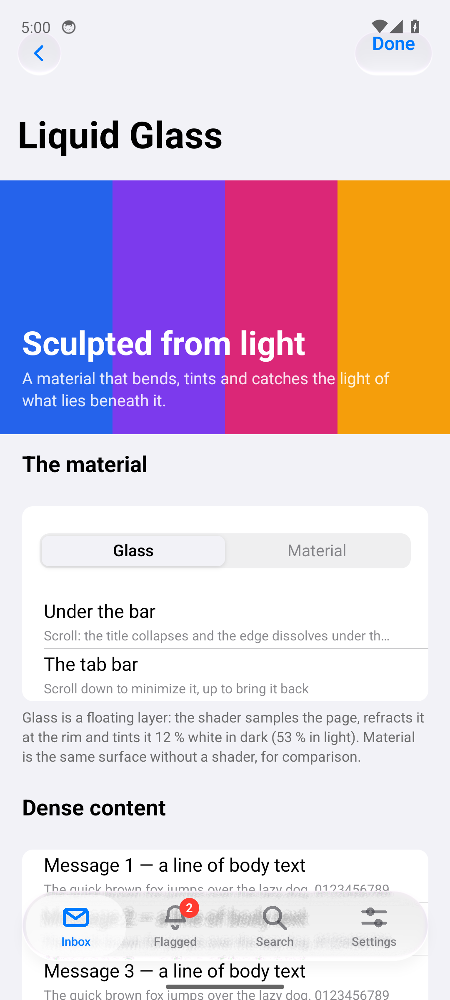
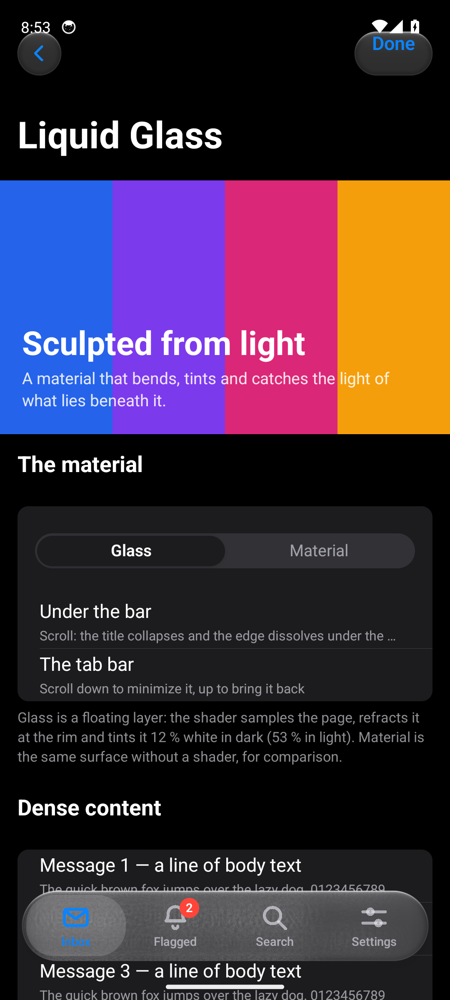
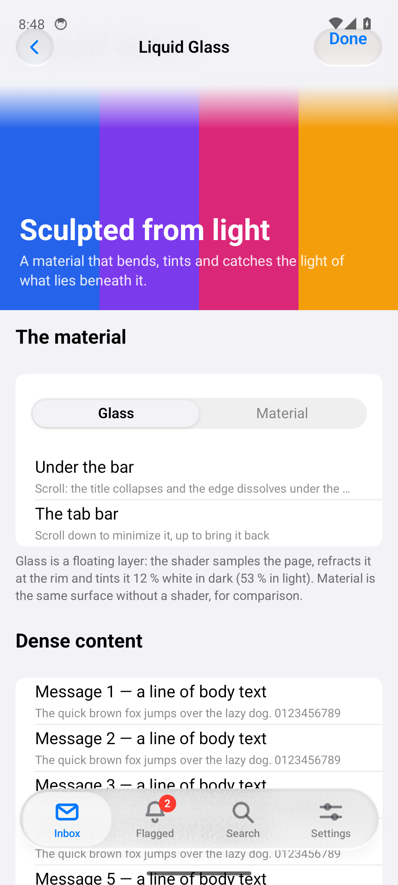
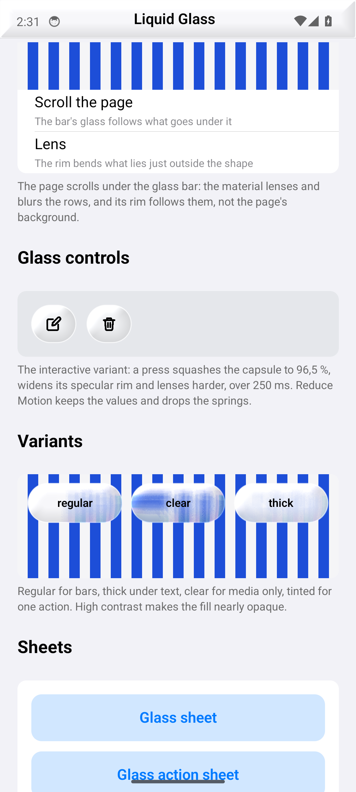
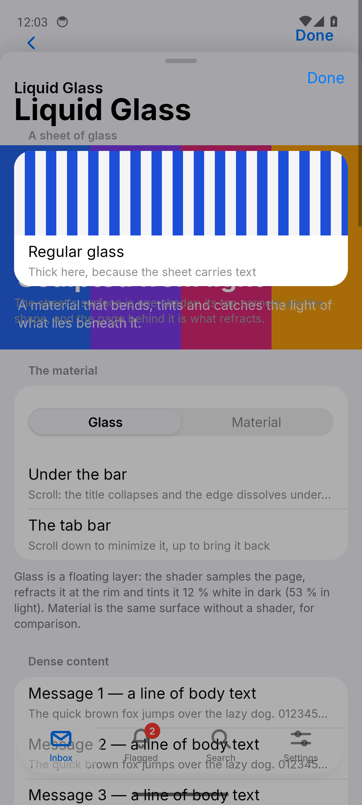

# nsh-cupertino 0.3.3

[English](v0.3.3.md)

液态玻璃材质在 Android 上真的画出来了：0.3.0 发布时如实写了"还没有在任何 Android 设备上
渲染过一帧"。这个补丁补上了那次运行，以及它留下的画面。

## 变更

- **CI 里的 Android 模拟器运行** —— `.github/workflows/android-ui.yml` 把演示应用打给
  `x86_64`，启动 API 34 设备（SwiftShader：CI 机器没有 GPU），安装并用 `adb` 驱动：浅色与
  深色、滚动到页面的条纹带位于栏下方、胶囊变体、玻璃 sheet，以及三种画法的校准页。同时打出 `arm64-v8a`
  包，供真机安装。
- **防住"静默失败"** —— `tools/android-glass-check.mjs` 在以下情况让这次运行失败：截图是空的
  （纯黑、单一颜色，也就是 shader 没编译出来时的样子）、窗口什么都没画、某一步没有改变画面、
  以及材质画出来却没有透镜效果。
- **两个平台共用一个截图分支** —— `tools/publish-shots.sh` 把一次运行的文件**加到**分支上，
  不再重置另一个平台的文件。

crate 本身没有变化：同样的组件、同样的 token、同样的数值。

## 证据

| | |
| --- | --- |
| 浅色，内容在栏下滚动 |  |
| 深色 |  |
| 滚动后，条纹带在栏下方 |  |
| 条纹上的三种胶囊 |  |
| 玻璃 sheet |  |

都是 1080×2400 的 `pixel_6` 规格，直接 `screencap` 取设备画面，含状态栏。这次运行用与 Web
像素测试相同的方式测量材质：在校准页上，胶囊压着一条位于边缘内侧 10pt 的硬边——模糊会让这条边
留在原地，透镜会让它移动：

- 胶囊背后那条蓝带，在穿过胶囊中部的一行上，页面上止于 **184 px**，材质填充下止于
  **157 px**，shader 下延伸到 **417 px**（浅色；深色为 386 px）：边缘把背后的画面放大了，
  这是填充做不到的；
- 深色确实是深色：页面顶部的平均亮度从浅色的 **0.86** 变为深色的 **0.23**，滚动、胶囊与
  sheet 每一步都改变了画面。

## 平台说明

| | |
| --- | --- |
| Android | CI 里是 wgpu 走 SwiftShader 的 OpenGL（API 34），真机上是 Vulkan 或 OpenGL：shader 绘制材质，平台在它之上绘制内容。由 `android-ui.yml` 验证。 |
| iOS、macOS、Windows、Linux | wgpu（Metal、Vulkan、Direct3D 12、OpenGL），不变：目前还没有模拟器或 CI 机器为它们绘制画面。 |
| Web | WebGL 2，仍需 `tools/patch-runtime.mjs` 的 uniform block 修复，直到 NSH 绑定两个阶段的 block。 |

## 升级

不需要改动：API、token 与行为都没有变。
