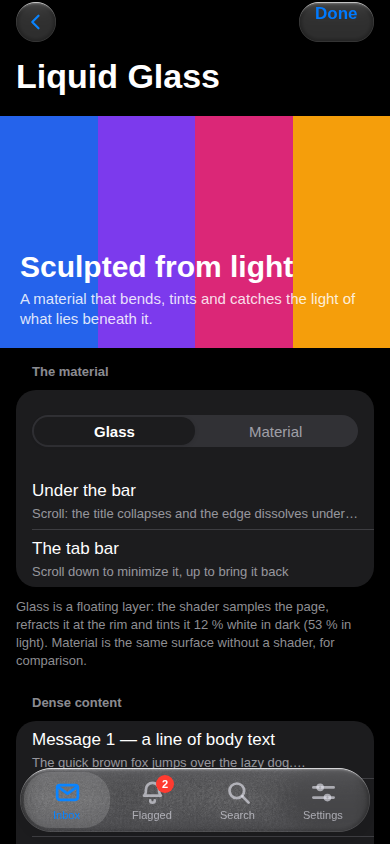
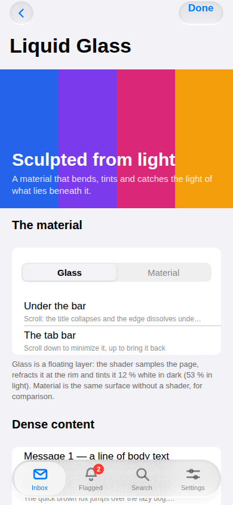
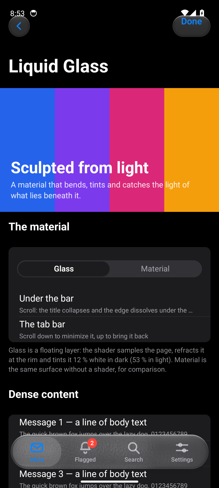

# nsh-cupertino 0.3.4

[简体中文](v0.3.4.zh-CN.md)

The demo's *Glass controls* panel follows the appearance: it was a hard-coded
light grey, and in dark mode it was the one light block on a dark page.

## What changed

- **One colour, from the tokens.** The panel behind the two `GlassButton`s is
  `bg-secondary-fill` (`tokens::secondary_fill`) instead of `#e5e7eb`. In light
  it is the same grey it was; in dark it is the darker fill the token names.
- **The rest of the demo's colours, audited.** What is still hard-coded is
  content, not a panel: the tinted cards (white text on a system colour), the
  gradient behind the materials, and the blue-and-white stripe picture the lens
  bends. The calibration page keeps its fixed backdrop on purpose — the pixel
  checks measure the material against it.

Nothing in the crate changed: same components, same tokens, same values.

## Evidence

| | |
| --- | --- |
| Dark, the panel under the two glass buttons |  |
| The same page in light |  |
| Android, dark (the emulator run) |  |

Every demo page is re-captured in light and dark from the web build and on the
Android emulator; nothing is a light panel on a dark page now. `tools/glass-shots.mjs`
and `tools/glass-pixels.mjs` still pass on the material's own stills.

## Upgrading

Nothing to do: an app's own panels are its own; this is the demo that changed.
