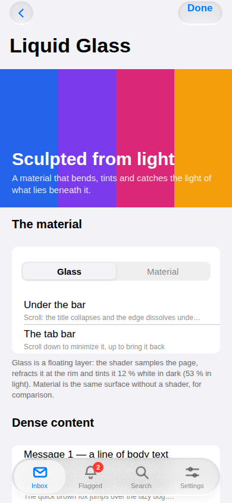
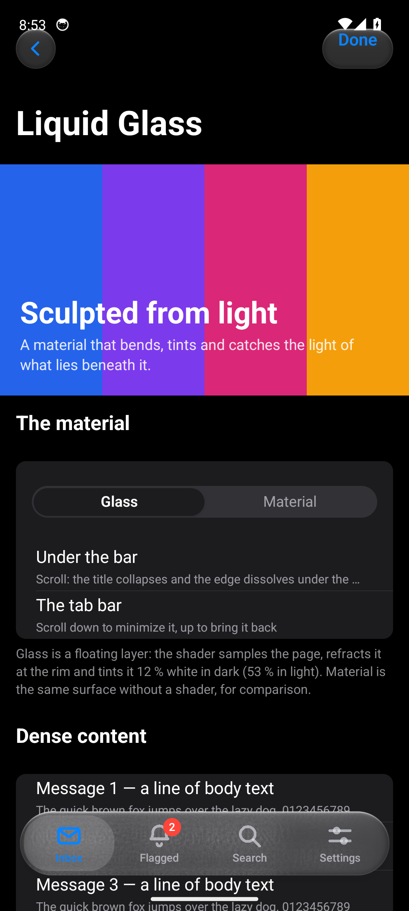

# nsh-cupertino 0.3.4

[English](v0.3.4.md)

演示应用的"Glass controls"面板跟随外观了：它原本是写死的浅灰，深色模式下是深色页面上唯一一块发光的亮块。

## 变更

- **一个颜色，来自 token。** 两个 `GlassButton` 背后的面板改用 `bg-secondary-fill`
  （`tokens::secondary_fill`），不再是 `#e5e7eb`。浅色下还是原来的灰，深色下是 token 指定的深填充。
- **演示应用其余的颜色都审过了。** 仍然写死的是**内容**，不是面板：着色的卡片（系统色上的白字）、
  材质页背后的渐变，以及透镜要弯折的蓝白条纹图。校准页固定浅色背景是刻意的——像素测试要拿它做基准。

crate 本身没有变化：同样的组件、同样的 token、同样的数值。

## 证据

| | |
| --- | --- |
| 深色，两个玻璃按钮下方的面板 |  |
| 同一页的浅色 |  |
| Android 深色（模拟器运行） |  |

每个演示页面都会用 Web 构建与 Android 模拟器重新拍摄浅色与深色；现在深色页面上没有发亮的浅色面板了。
`tools/glass-shots.mjs` 与 `tools/glass-pixels.mjs` 在材质自己的画面上仍然通过。

## 升级

不需要改动：应用自己的面板由应用决定；这次改的是演示应用。
