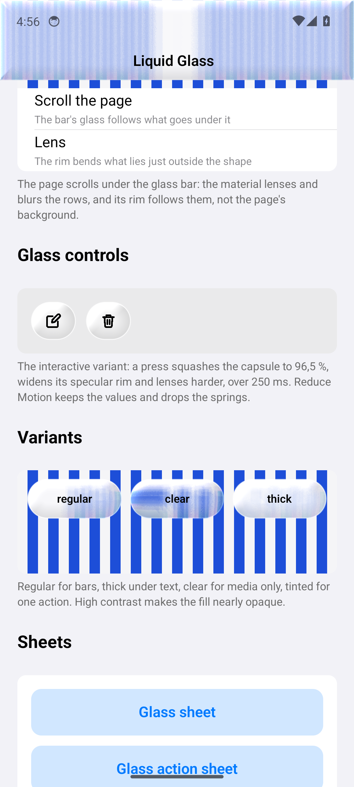
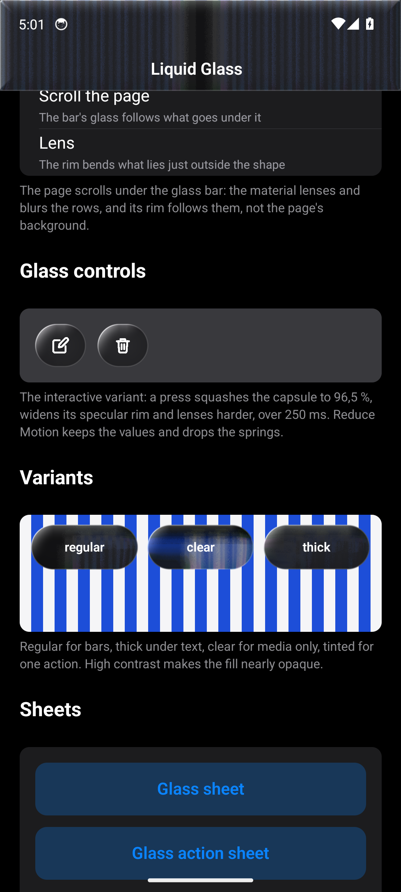
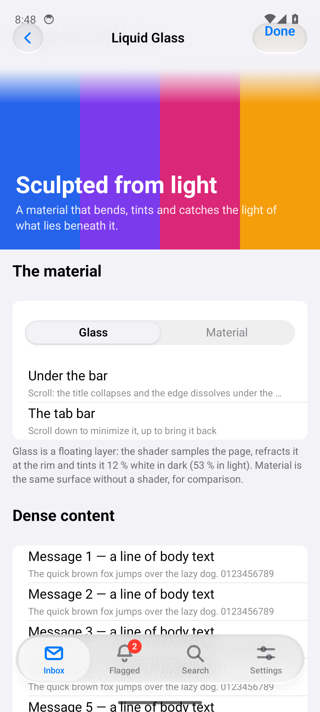
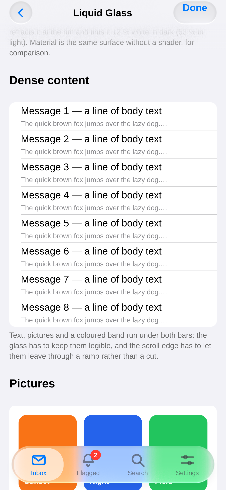

# nsh-cupertino 0.3.5

[简体中文](v0.3.5.zh-CN.md)

The bar has a backdrop again. On Android it had none: the page's scrolling
content ended at the bar's lower edge, so the glass sampled the page's own fill
and drew as a white (light) or black (dark) slab with a rim. That is
[#16](https://github.com/markbang/nsh-cupertino/issues/16), and it is fixed at
the root in `NavPage`.

## What changed

- **The bar is a layer over the scroll, on every platform.** `NavPage` no longer
  leaves the bar to the layout's flow: the bar is an absolute layer, the content
  runs to the top edge padded by the bar plus the safe-area inset, and it scrolls
  under the bar from the first frame. On the web that is what a page with a
  `material` already did; on Android the scroll view's viewport began at the
  bar's lower edge even then, so the glass read the page's fill.
- **`material` picks the surface, not the layout.** `"opaque"` (the default)
  draws the bar's fill over the content; `"regular"`, `"thin"`, `"ultra-thin"`,
  `"thick"` and `"chrome"` draw the glass. Both float now, so a page's rows pass
  under an opaque bar too, as on iOS. Existing pages need no change.
- **The bar draws into the status bar.** Its fill and glass reach the top edge,
  and its 44 pt row sits below the safe-area inset; the content's top padding is
  the same bar-plus-inset, so the two line up. The pull-to-refresh indicator sits
  at the bar's lower edge.
- **A frame with the band behind the bar, and a check that fails a flat bar.**
  The Android run scrolls the Glass page until `tools/android-bar.mjs` reads the
  stripes' blue in the bar's own row, captures
  `android-glass-behind-{light,dark}.png`, and `tools/android-glass-check.mjs`
  fails the run when that row is one colour — a page that stops at the bar's
  edge. It prints the row's colours and blue share against the page's own band.

## Evidence

| | |
| --- | --- |
| Android, the striped band behind the bar (light) |  |
| Android, the same in dark |  |
| Android, the page scrolled so the band meets the bar |  |
| Web, the same page scrolled |  |

The Android stills are from the emulator run (1080×2400 `pixel_6`, API 34,
SwiftShader). The check reads the bar's own row as **16 colours, 90 % of it the
stripes' blue** in light and **16 colours, 48 %** in dark, against the page's
band at **30 stripes, 49 % blue**; before the fix the same row read **1–4
colours, 0 % blue**, and the driver's probe scrolled again rather than accept
it. `tools/android-glass-check.mjs` still measures the material itself on the
calibration page: the blue field ends at 184 px on the page, 157 px through the
fill and 417 px through the shader in light (386 px in dark).

## What is still not iOS 26

- **A soft light column behind the compact title.** On a wide bar over a striped
  or coloured backdrop the glass shows a pale vertical column around the title,
  on the web as well as on Android. It predates this release (it is in the 0.3.4
  stills) and is not the layout: it is the bar's own drawing, and it needs its own
  look at the material's backdrop sampling.
- **No scroll-edge effect.** iOS 26 fades and thins content as it approaches the
  bar's edge; `NavPage`'s material blurs what is under it but draws no separate
  edge treatment.

## Upgrading

Nothing to do: `NavPage`'s props and events are unchanged, and a page without a
`material` now scrolls under its opaque bar the way iOS does.
