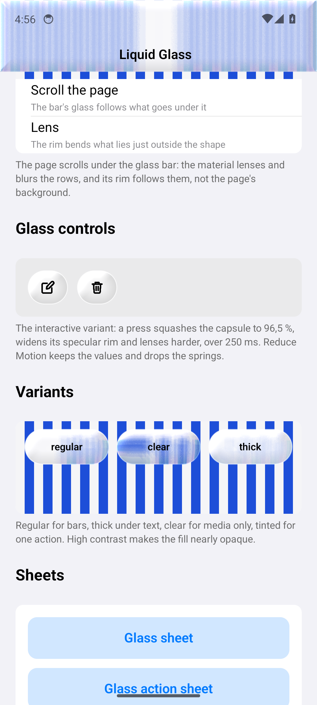
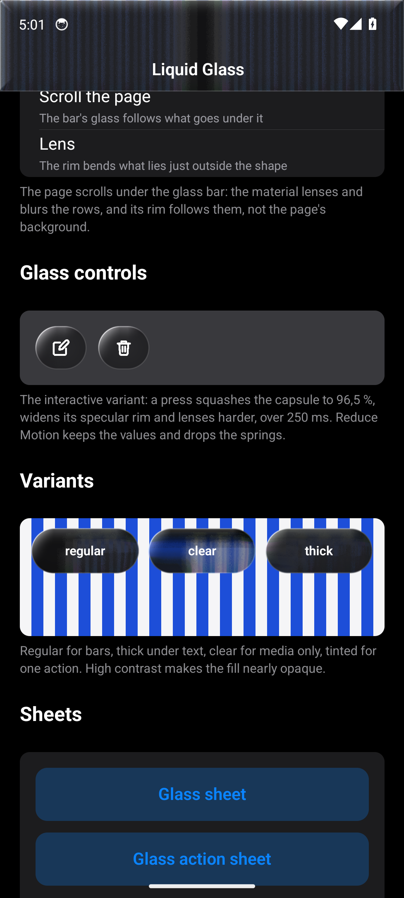
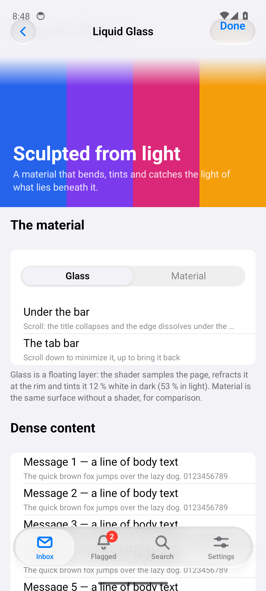
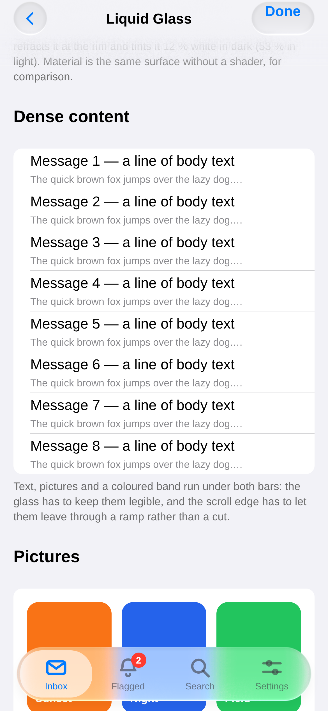

# nsh-cupertino 0.3.5

[English](v0.3.5.md)

栏又有背景了。Android 上它没有：页面滚动内容的视口止于栏的下沿，玻璃取到的是页面自身的填充，
于是画成一块带边缘高光的白色（浅色）或黑色（深色）板子。这就是
[#16](https://github.com/markbang/nsh-cupertino/issues/16)，现在在 `NavPage` 里从根上修掉了。

## 变更

- **栏覆盖在滚动内容之上，所有平台一致。** `NavPage` 不再把栏交给布局的流：栏是绝对定位的一层，
  内容一直排到屏幕顶边、按栏高加安全区留出内边距，并从第一帧起就从栏下滚过。Web 上带 `material`
  的页面本来就是这样；Android 上即使设置了 `material`，滚动视图的视口也从栏的下沿开始，所以玻璃
  读到的是页面填充。
- **`material` 只决定表面，不决定布局。** `"opaque"`（默认）在内容上画栏的填充；`"regular"`、
  `"thin"`、`"ultra-thin"`、`"thick"`、`"chrome"` 画玻璃。两者现在都浮在内容上，所以不透明栏下
  的内容也会滚过，与 iOS 一致。已有页面不需要改动。
- **栏画进状态栏。** 它的填充与玻璃一直画到屏幕顶边，44 pt 的一行位于安全区之下；内容的顶部内边距
  是同样的栏高加 inset，两者对齐。下拉刷新的指示器位于栏的下沿。
- **一帧"条纹带在栏后"的画面，以及一条"栏是平的就失败"的检查。** Android 运行会把 Glass 页滚动
  到 `tools/android-bar.mjs` 在栏自己那一行读到条纹的蓝色，拍下
  `android-glass-behind-{light,dark}.png`；如果那一行只有一种颜色（页面停在栏边缘），
  `tools/android-glass-check.mjs` 就让这次运行失败。它会把那一行的颜色数与蓝色占比打印出来，
  并与页面自己的条纹带对照。

## 证据

| | |
| --- | --- |
| Android，条纹带在栏后（浅色） |  |
| Android，同样场景（深色） |  |
| Android，页面滚动到条纹带与栏相接 |  |
| Web，同一页滚动后的样子 |  |

Android 截图来自模拟器运行（1080×2400 `pixel_6`、API 34、SwiftShader）。检查读到栏自己那一行在浅色下是
**16 种颜色、90 % 为条纹的蓝色**，深色下是 **16 种颜色、48 %**；页面自己的条纹带是 **30 条、49 % 蓝色**。
修复前同一行是 **1–4 种颜色、0 % 蓝色**，驱动的探针会继续滚动而不是接受这一帧。
`tools/android-glass-check.mjs` 仍然在校准页上测量材质本身：浅色下蓝色区域在页面止于 184 px，
透过填充到 157 px，透过 shader 到 417 px（深色 386 px）。

## 仍与 iOS 26 有差距的地方

- **紧凑标题背后一条柔和的光柱。** 宽栏压在条纹或彩色背景上时，玻璃在标题周围会出现一条偏白的
  竖向光柱，Web 与 Android 都有。它在本版之前就存在（0.3.4 的截图里就有），也不是布局造成的：
  它来自栏自身的绘制，需要单独检查材质的背景采样。
- **没有 scroll edge effect。** iOS 26 会让内容接近栏边缘时淡出、变薄；`NavPage` 的材质会模糊
  下面的内容，但没有单独的边缘处理。

## 升级

不需要改动：`NavPage` 的属性与事件没变；没有 `material` 的页面现在也会让内容从自己的不透明栏下滚过，
与 iOS 一致。
