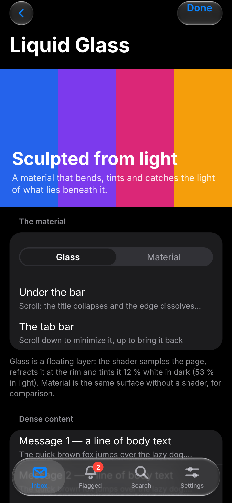
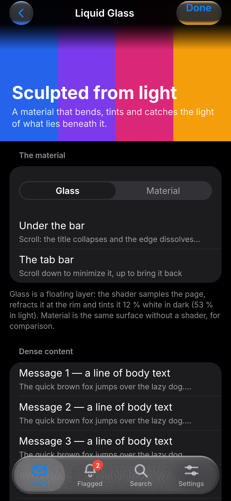
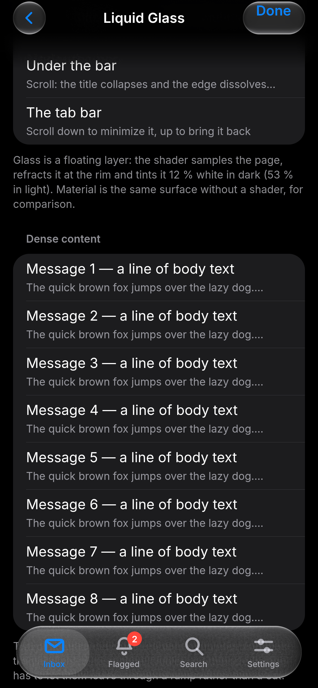
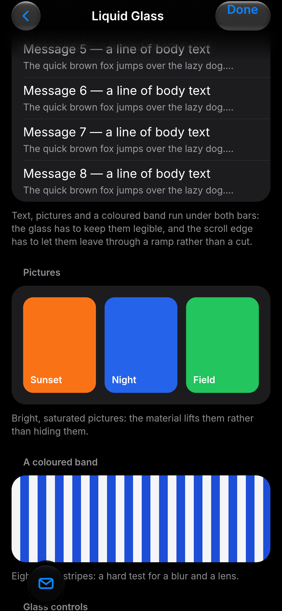
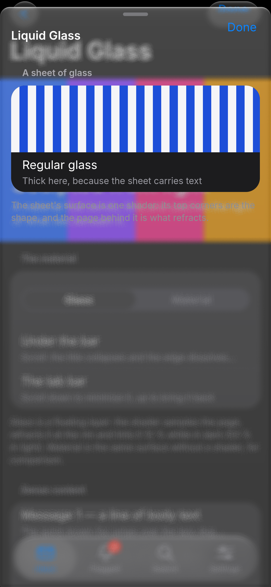
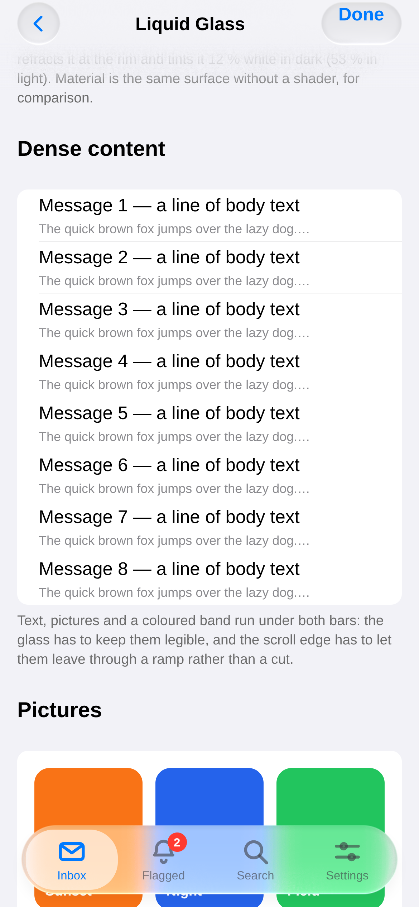

# nsh-cupertino 0.4.0

[简体中文](v0.4.0.zh-CN.md)

Liquid Glass is a design language, not a material. 0.3.x had the material: a
shader that refracted and tinted its backdrop. It did not have the structure
around it — a tab bar that floats as an inset capsule and gets out of the way as
you read, a navigation bar whose controls float over the page, a scroll edge
that dissolves content under them — and its material was a dark frosted slab
rather than Apple's luminous glass. This release builds the structure, retunes
the material against iOS 27's own calibrated numbers, and adds the measurements
that keep it there.

This is a **visual breaking change**: a floating bar sits differently, insets its
content differently, and a `NavPage` with a `material` no longer draws a
full-width band. Pages that only use solid bars are unchanged.

## Added

- **`GlassTabBar` — the floating capsule tab bar.** 64 pt tall, radius 32, 20 pt
  from the sides and 12 pt above the home indicator, so the page scrolls behind
  and *around* it. The chosen tab sits in a capsule of its own; a downward scroll
  minimises the bar to a 50 pt pill around that tab, an upward scroll expands it
  again. The behaviour is UIKit's `UITabBarController.MinimizeBehavior`:
  `on-scroll-down` (the default), `on-scroll-up` or `never`, with the reference
  implementation's thresholds (20 pt down to minimise, 12 pt up to expand,
  nothing shorter than 40 pt of content ever minimises), a 0.78/340 spring and
  the whole bar lifting 6 pt as it shrinks.
- **A floating navigation bar in `NavPage`.** With a `material`, the back button
  (a 40 pt glass circle), the title and the trailing action (a glass capsule)
  float over the content 16 pt from the sides and 8 pt below the safe area; there
  is no full-width band and no hairline, and the large title collapses into the
  floating group as you scroll. Pressing the title still scrolls to the top.
- **`ScrollEdge` — the scroll edge effect.** A graduated blur and fade at the top
  or bottom of a page: 20 pt of blur at the edge, sharp 110 pt in, a short fade
  into the page's background, and a reveal that runs 0 → 1 over the first 26 pt
  of scroll, so the glass is nearly invisible at rest and hardens as content
  slides under it. It works on Android and the web (`ShaderEffect` +
  `sample_backdrop`).
- **`NavPageEvent::Scroll(offset)`** (`onScroll`), so a page can drive a
  `GlassTabBar`'s `scrollOffset` from its own scroll view.
- **Measurable acceptance checks.** `tools/glass-pixels.mjs` now asserts, on the
  calibration stills, that (a) the structure under the glass survives
  (correlation ≥ 0.25 light / 0.35 dark over rows that carry content, and the
  fill-only material keeps less), (b) dark glass is lighter than its backdrop and
  inside the reference band 0.06–0.34, (c) the rim displaces the blue edge
  ≥ 1.5 pt, and (d) the lit edge is measurably brighter than the opposite one.
  `tools/android-glass-check.mjs` measures the same on the emulator, and adds the
  structure checks: the bar spans ≥ 60 % of the screen expanded and ≤ 45 %
  minimised, and content shows in the 20 pt either side of the capsule.
- `docs/design-notes.md` now carries the Liquid Glass numbers, their sources and
  the list of remaining differences from Apple.

## Improved

- **The material, retuned to iOS 27.** `glass-regular` is `#F8F8F8` at 53 % in
  light and `#FFFFFF` at 12 % in dark (it was `#1C1C1E` at 66 % — a black slab);
  backdrop saturation 2.1 light / 1.4 dark; a luminance-weighted frost (opacity
  0.73/0.85, clamp +0.40/−0.45, weight 2.0/0.5); a body shade of 0.28 in dark; a
  paraxial lens of 32 pt at n = 1.24; the iOS 27 rim — a hairline plus a lit lobe
  one point inside the edge and a soft 8 pt tail, from above in dark and below in
  light; blur down from 20 pt to 5 pt (the 3–8 pt band, so detail survives); the
  adaptive tint thickening only behind labels and capped at 70 %; the iOS 27
  shadow (`#0A000000`, blur 10, y 7) in light and none in dark.
- **The timer of the backdrop sample.** The shader mapped its own box to the
  middle of the backdrop texture instead of the whole of it, so the lens had been
  sampling the wrong pixels at the rim; the calibration's blue edge now moves
  10–16 pt where it did not before.
- **The glass on the bars.** `TabBar`'s edge-to-edge bar stays for pages that
  want it; `GlassTabBar` is the floating one.

## Fixed

- The lens sampling offset (above), which made refracted edges read as a smear
  rather than a bend.
- The dark material's black fill (above), which made every bar a frosted slab.

## Evidence

Web (390 × 844 at 3×, light and dark, real build):

| | |
| --- | --- |
| Content at the top: the controls float, the edge effect is off |  |
| Mid-scroll: the ramp dissolves the content under the controls |  |
| Scrolled: the tab bar expanded over pictures, content around it |  |
| Scrolled down: the bar minimised to the chosen tab |  |
| The sheet |  |
| Same states in light |  |
| The "material" side of the comparison |  |

Android: the same set at real resolution, light and dark, from the emulator job
(`tools/android-glass.sh`, published to the `screenshots` branch).

Before (0.3.5) and after, dark, at rest — the same page:

| 0.3.5 | 0.4.0 |
| --- | --- |
|  |  |

## What is still different from Apple

- The frost is one pass of 9–17 taps, not a separate blur pass read from
  interleaved rows: very dense texture loses a little more structure than iOS's,
  and `quality="low"` can band.
- The lens is paraxial, not a full hemispherical bevel: slightly flatter
  magnification deep inside the rim.
- The minimise morph interpolates two silhouettes and cross-fades the content;
  UIKit morphs the real views and carries the icons through.
- The shadow is a box shadow, not the native elevation-aware one.
- NSH's web painter leaves gradients and rotations out of a shader's backdrop
  picture (native builds capture the whole window), so the demo's pictures behind
  the glass are solid blocks.
