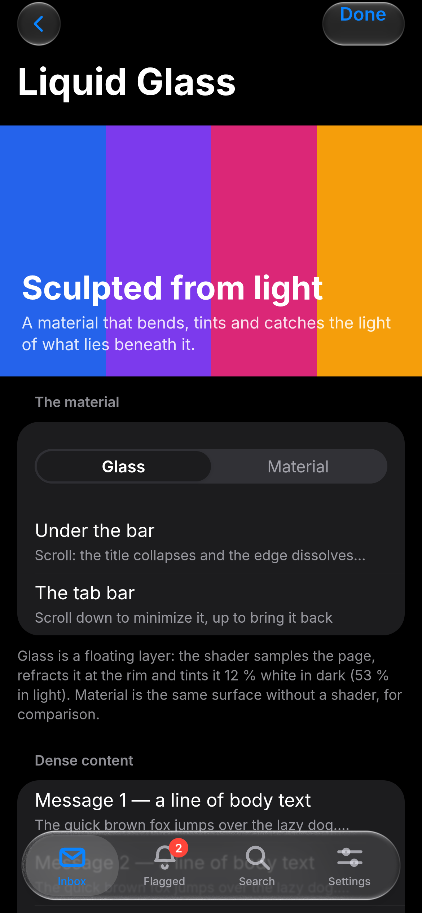
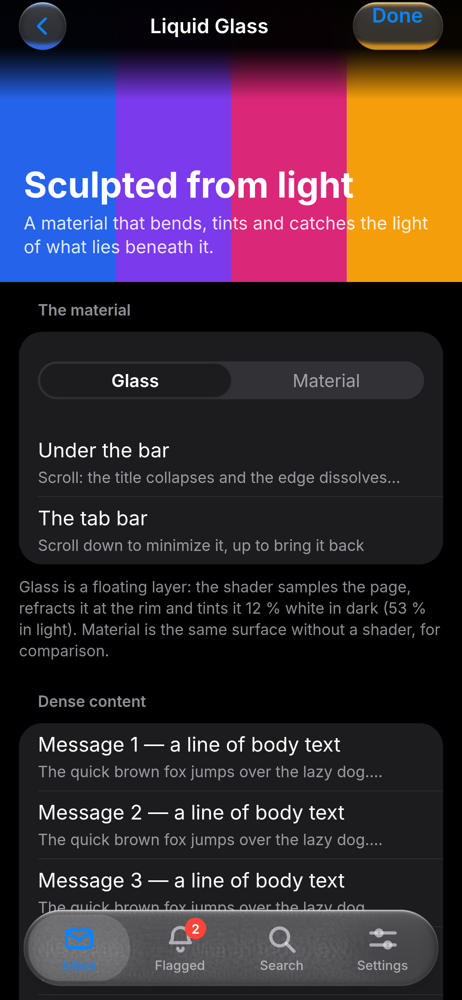
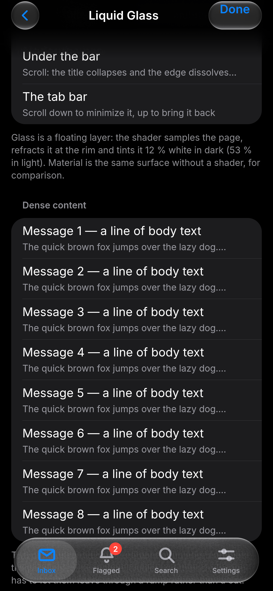
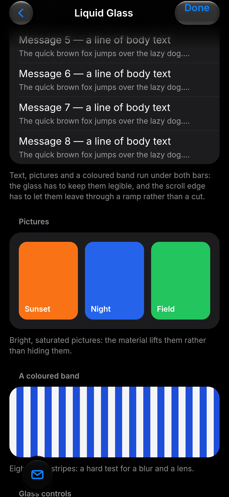
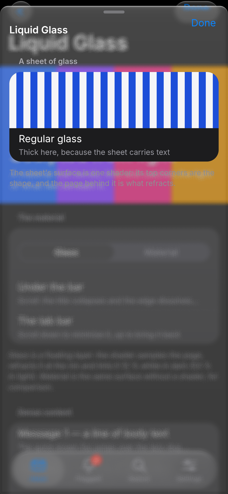
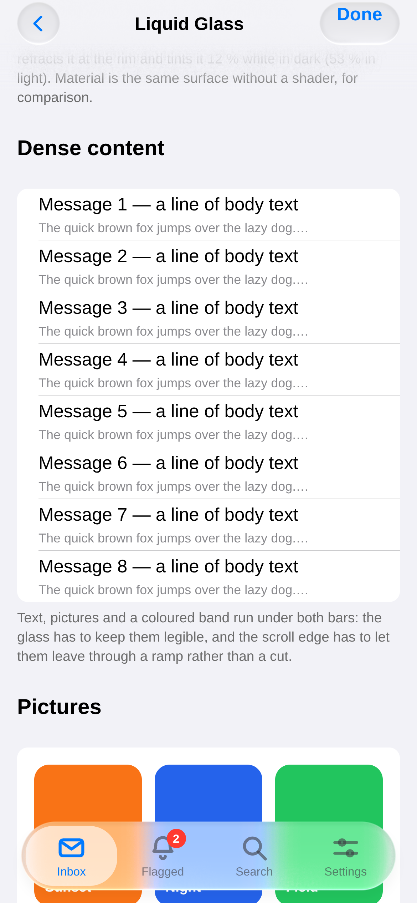

# nsh-cupertino 0.4.0

[English](v0.4.0.md)

Liquid Glass 是一套设计语言，不只是材质。0.3.x 只有材质：一个会折射、会给背景上色的着色器。
它周围的结构没有：标签栏不会作为一个内缩胶囊浮起来、也不会在阅读时让开；导航栏的控件不会浮在页面之上；
滚动边缘不会把控件下面的内容化开——而且材质是一块深色磨砂板，不是 Apple 那种会发光的玻璃。
这个版本补上结构，按 iOS 27 自己校准过的数字重调材质，并加上把它固定住的实测检查。

这是一次**视觉上的破坏性变更**：浮动栏的位置不同、给内容留的内边距不同，带 `material` 的 `NavPage`
也不再画一条整宽的栏。只用不透明栏的页面不受影响。

## 新增

- **`GlassTabBar`：浮动胶囊标签栏。** 高 64 pt、圆角 32、两侧各内缩 20 pt、home indicator 之上 12 pt，
  页面在它后面以及**四周**继续滚动。所选标签有自己的胶囊；向下滚动时栏收成环绕该标签的 50 pt 胶囊，
  向上滚动再展开。行为就是 UIKit 的 `UITabBarController.MinimizeBehavior`：`on-scroll-down`（默认）、
  `on-scroll-up` 或 `never`，阈值取自参考实现（向下 20 pt 收起、向上 12 pt 展开、内容不足 40 pt 永不收起），
  弹簧阻尼 0.78、刚度 340，收缩时整条栏上移 6 pt。
- **`NavPage` 的浮动导航栏。** 设置 `material` 时，返回键（40 pt 玻璃圆）、标题与尾部操作（玻璃胶囊）
  浮在内容之上，距两侧 16 pt、安全区下 8 pt；不再有整宽栏和分隔线，大标题在滚动时收进浮动组。
  点标题仍然回到顶部。
- **`ScrollEdge`：滚动边缘效果。** 页面顶部（或底部）的渐进模糊与淡出：边缘 20 pt 模糊，到 110 pt 处
  清晰，另有一小段淡入页面背景；“显现”随最初 26 pt 滚动从 0 到 1，所以静止时几乎看不见，内容滑到下面
  时逐渐变硬。Android 与 Web 都可用（`ShaderEffect` + `sample_backdrop`）。
- **`NavPageEvent::Scroll(offset)`**（`onScroll`），页面可以用自己的滚动视图驱动 `GlassTabBar` 的
  `scrollOffset`。
- **可度量的验收检查。** `tools/glass-pixels.mjs` 在标定截图上断言：(a) 玻璃下的结构仍然存在
  （在有内容的行上相关性 ≥ 0.25 浅色 / 0.35 深色，且仅填充的材质保留得更少），(b) 深色玻璃比背景更亮、
  且落在参考区间 0.06–0.34，(c) 边缘把蓝边位移 ≥ 1.5 pt，(d) 受光边明显比对边亮。
  `tools/android-glass-check.mjs` 在模拟器上测同样的性质，并加上结构检查：展开时栏占屏宽 ≥ 60 %、
  收起后 ≤ 45 %，胶囊两侧 20 pt 显示的是内容。
- `docs/design-notes.md` 现在记录 Liquid Glass 的数字、来源，以及与 Apple 尚存的差异清单。

## 改进

- **材质按 iOS 27 重调。** `glass-regular` 浅色为 `#F8F8F8` 53 %、深色为 `#FFFFFF` 12 %
  （原来是 `#1C1C1E` 66 %，一块黑板）；背景饱和度 2.1 / 1.4；带亮度权重的霜（不透明度 0.73/0.85，
  钳制 +0.40/−0.45，权重 2.0/0.5）；深色主体压暗 0.28；32 pt、n = 1.24 的近轴透镜；iOS 27 的边缘高光——
  一条细线，加上边缘内 1 pt 的受光瓣与约 8 pt 的柔和尾部，深色自上、浅色自下；模糊从 20 pt 降到 5 pt
  （3–8 pt 区间，结构得以保留）；自适应色调只在文字后面加厚且上限 70 %；浅色用 iOS 27 的阴影
  （`#0A000000`、模糊 10、y 7），深色不画。
- **背景采样的坐标。** 着色器把自己所在的框映射到背景贴图的正中而不是整张，边缘处的透镜一直在采错的像素；
  标定页的蓝边现在会位移 10–16 pt，之前不会。
- **栏上的玻璃。** `TabBar` 的整宽栏保留给需要它的页面；`GlassTabBar` 是浮动的那一个。

## 修复

- 透镜的采样偏移（见上）：折射的边缘之前是一团拖影而不是弯折。
- 深色材质的黑色填充（见上）：之前每条栏都是一块磨砂板。

## 证据

Web（390 × 844，3×，浅色与深色，真实构建）：

| | |
| --- | --- |
| 内容在顶部：控件浮着，边缘效果关闭 |  |
| 滚动中：边缘渐变把控件下的内容化开 |  |
| 已滚动：标签栏展开在图片上，四周都是内容 |  |
| 向下滚动：栏收成所选标签的胶囊 |  |
| 表单 |  |
| 浅色的同样状态 |  |
| 对照用的 "material" 一侧 |  |

Android：同样的一组，真机分辨率、浅色与深色，来自模拟器任务（`tools/android-glass.sh`，发布到
`screenshots` 分支）。

0.3.5 与 0.4.0，深色、静止、同一页面：

| 0.3.5 | 0.4.0 |
| --- | --- |
|  |  |

## 与 Apple 仍存在的差异

- 霜只有一趟 9–17 次采样，不是独立的一遍模糊加隔行读取：非常密的纹理保留的结构比 iOS 略少，
  `quality="low"` 可能出色带。
- 透镜是近轴的，不是完整的半球斜边：边缘深处的放大略平。
- 最小化是两条轮廓的插值加内容交叉淡入；UIKit 是真实视图的形变，图标会跟着走。
- 阴影是 box shadow，不是原生那种带高度的。
- NSH 的 Web 绘制器不会把渐变与旋转画进着色器的背景图（原生构建捕获整个窗口），所以演示页玻璃后的
  图片是纯色块。
