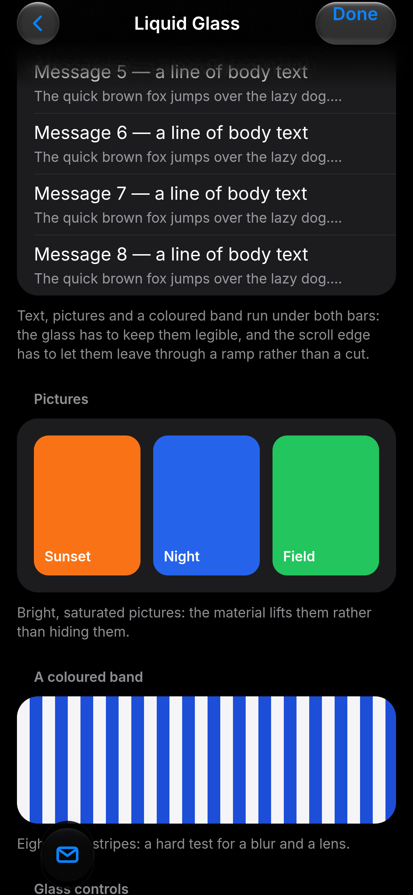
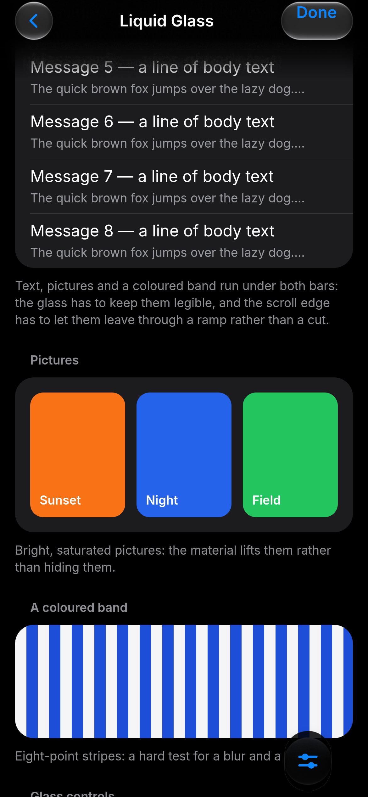

# nsh-cupertino 0.4.1

[简体中文](v0.4.1.zh-CN.md)

Two defects in `GlassTabBar`'s minimised pill, both caught by using the bar
rather than by its first screenshot.

## Fixed

- **The pill follows the chosen tab.** Its `left` and the glass silhouette's
  anchor were evaluated once, when the bar was built, and the pill's icon was the
  tab chosen at that moment. A bar built with Inbox chosen kept showing Inbox's
  tray at Inbox's slot after Settings was chosen while minimised. The pill's
  position now reads the live selection (it springs to the new slot) and it
  builds one icon per tab, showing the chosen one. The same value drives the
  shader's anchor, so the glass and the picture cannot disagree.
- **The pill is a picture, not a target.** It lay over the chosen tab at
  opacity 0 and took touches, so tapping the tab you were on did nothing — the
  "tap the chosen tab to go back to its first page" gesture was lost. It is
  `pointer-events: none` now.
- **A bar that re-mounts rebuilds from the live selection**, not from what it
  was first built with: Android's restore showed a bell or magnifier pill for a
  bar whose chosen tab was Inbox. The state machine, the pill's slot and the
  glass anchor all start from the selection the bar is given and follow it from
  there.

## What the pill does now

When the bar minimises, the chosen tab's icon sits in a 50 pt glass pill at that
tab's slot. If the selection changes while the bar is minimised — another tab
picked, or the app restoring a different page — the pill slides to the new slot
with a spring, keeps the glass silhouette under it (both read the same animated
anchor), and shows the new tab's icon. It never intercepts a touch.

## Checks

`tools/glass-pixels.mjs` reads two new web stills of the same page — Inbox
chosen, then Settings chosen *after mount*, both scrolled — finds the pill's
system-blue icon and fails the run when it is not at that tab's slot
(±24 pt of 63.75 / 326.25 pt) or when the two positions are less than 200 pt
apart. It also compares the two icons' pixels, so a correct position with the
wrong glyph fails too. `tools/android-glass-check.mjs` does the same on the
emulator after tapping Settings, and the demo and the driver gained that tap.

## Evidence

Web, 390 × 844 at 3×, dark, minimised after scrolling:

| Inbox chosen (mount) | Settings chosen after mount |
| --- | --- |
|  |  |

The Android frames of the same two states are published with the other captures
(`android-glass-tabmin-*` and `android-glass-tabmin-settings-*` on the
`screenshots` branch).

## Verification

`cargo fmt`, `cargo clippy --all-targets -- -D warnings`, the crate's tests, the
web build with `tools/glass-pixels.mjs`, the site's headless checks and the
Android emulator run (`tools/android-glass.sh` and
`tools/android-glass-check.mjs`), all on the pull request.
