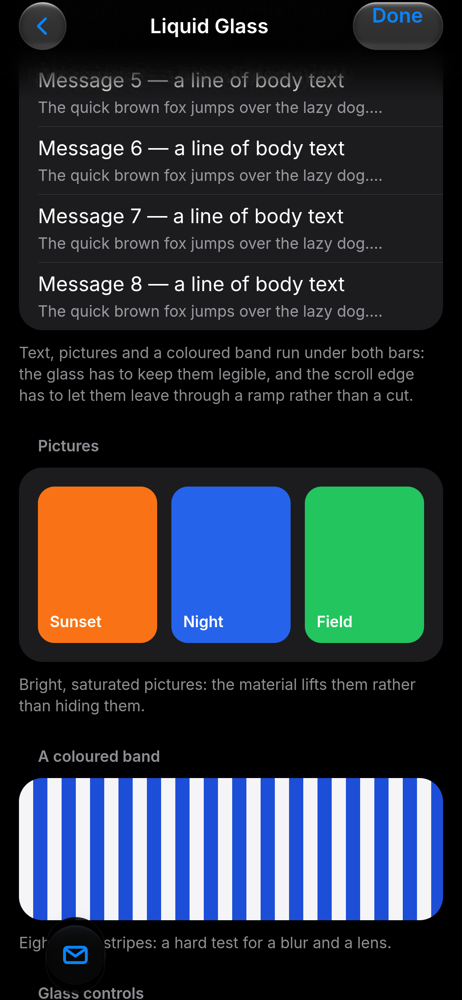
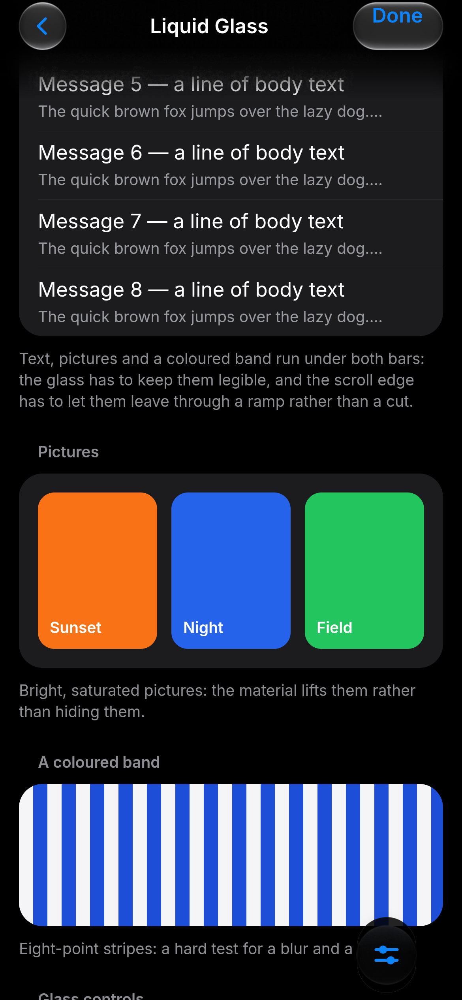

# nsh-cupertino 0.4.1

[English](v0.4.1.md)

`GlassTabBar` 最小化胶囊的两个缺陷，都是真正用起来才会发现的，而不是第一张截图能看出来的。

## 修复

- **胶囊跟随所选标签。** 它的 `left` 与玻璃轮廓的锚点在栏构建时只算了一次，胶囊的图标也是那一刻选中的标签。
  以 Inbox 构建的栏，在最小化时改选 Settings 之后，仍然显示 Inbox 的托盘、停在 Inbox 的位置。
  现在位置读取实时的选择（用弹簧滑到新位置），并给每个标签各建一个图标、只显示所选的那个。
  同一个值也驱动着色器的锚点，所以玻璃与画面不会再对不上。
- **胶囊只是画面，不是点击目标。** 它以 0 不透明度盖在所选标签上并接收触摸，于是点按当前标签没有反应——
  “点当前标签回到它的第一页”的手势丢失了。现在它是 `pointer-events: none`。

## 检查

`tools/glass-pixels.mjs` 读取同一页面的两张新 Web 截图——先选 Inbox，再**在挂载之后**选 Settings，
两张都滚动到底——找到胶囊上的 systemBlue 图标，当它不在该标签的槽位（63.75 / 326.25 pt 的 ±24 pt 内），
或两个位置相差不到 200 pt 时让构建失败。它还比较两个图标的像素，位置对、图形错也会失败。
`tools/android-glass-check.mjs` 在模拟器上点按 Settings 后做同样的检查，演示页与驱动脚本也加上了这个点按。

## 证据

Web，390 × 844、3×、深色、滚动后的最小化状态：

| 挂载时选中 Inbox | 挂载后选中 Settings |
| --- | --- |
|  |  |

Android 上同样两个状态的帧与其他截图一起发布（`screenshots` 分支上的
`android-glass-tabmin-*` 与 `android-glass-tabmin-settings-*`）。

## 验证

`cargo fmt`、`cargo clippy --all-targets -- -D warnings`、crate 的测试、Web 构建加
`tools/glass-pixels.mjs`、站点的无头检查，以及 Android 模拟器运行
（`tools/android-glass.sh` 与 `tools/android-glass-check.mjs`），都在 pull request 上跑过。
