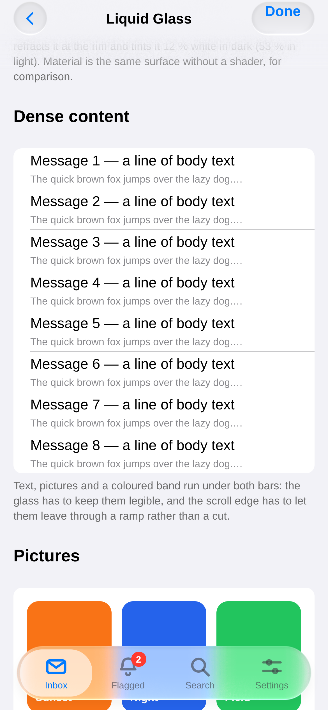
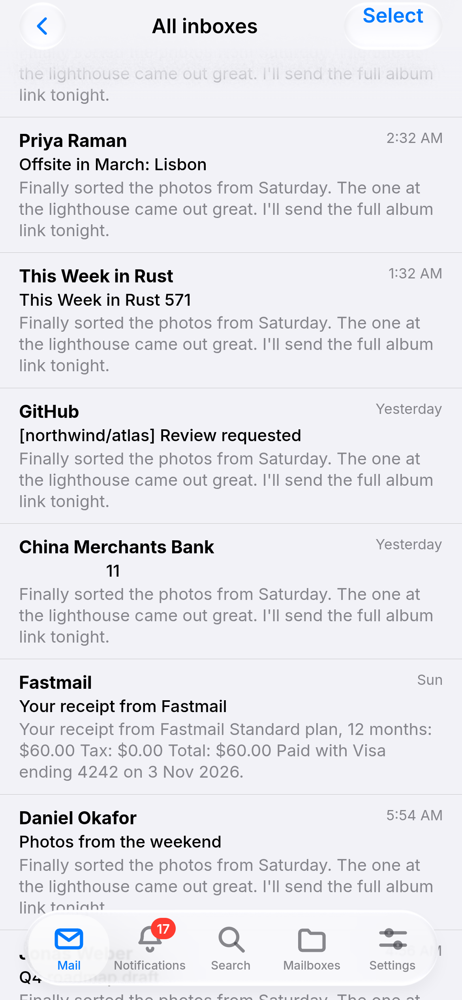
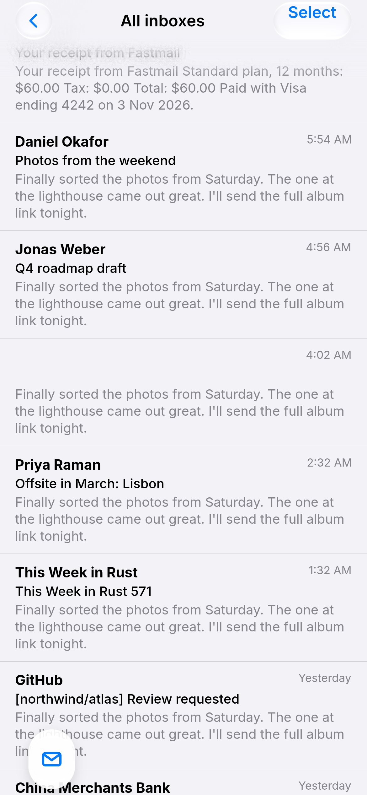
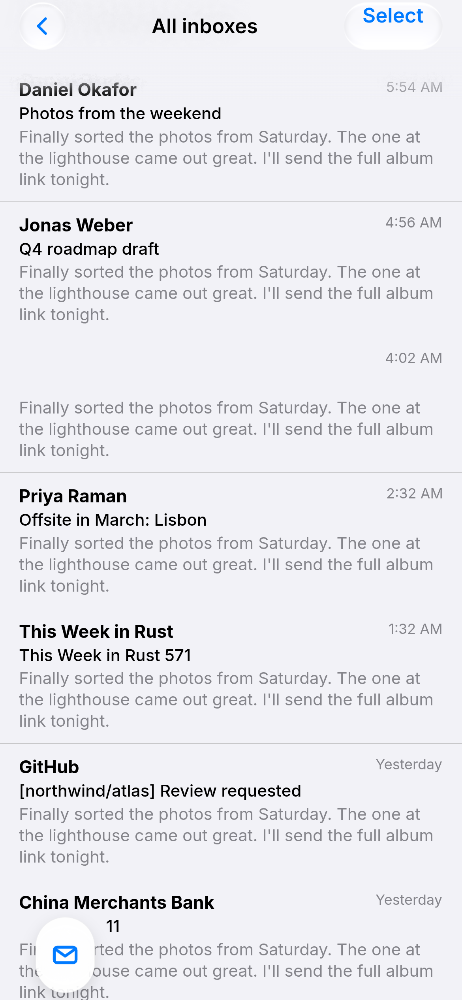

# nsh-cupertino 0.4.2

[简体中文](v0.4.2.zh-CN.md)

The bars were built and tuned over the demo's colour blocks; on the surface they
actually float over — a white page of 14 pt dark rows — three things read as
dirty rather than glass, and one as a defect. This release fixes all four and
adds the checks that keep them fixed, measured on a rows page rather than on
blocks.

## Fixed

- **No text reads through the bar.** The bar's backdrop blur was the material's
  5 pt, and 14 pt text at 5 pt is still text: rows showed as sharp grey streaks,
  in dark mode too. A bar now frosts at 24 pt with 33 taps (the disc's noise at
  that radius was visible as grain at 17), so the same rows are a soft haze with
  no legible strokes.
- **Light glass is a surface on white.** Over white rows the capsule read as
  +7–12 levels and its rim was invisible, and the minimised pill disappeared
  except for its icon. The light material now lifts a further 5 % toward white,
  the hairline is stronger with a soft band inside it, and the minimised pill is
  a page-coloured disc at 92 % with a hairline and the iOS 27 shadow — visible on
  white rows without looking at the icon. Dark mode's pill shadows none, as
  iOS 27 does.
- **The scroll edge reaches the page's colour.** It used to leave a grey wash
  (band 214 against a 240 page) with ghost strokes and a hard lower edge. An
  opaque band in the page's own colour now covers the controls, a `smoothstep`
  reaches clear with a flat tangent below the bar, and the blur stays at 18–40 pt
  across the ramp: the band reads 0.954 against the page's 0.950, its deviation
  0.000, and no stroke survives.
- **No chromatic fringe.** The rim's chromatic separation is off; on white it
  showed as a blue-violet edge on the selected tab's capsule.

## Checks

`tools/glass-pixels.mjs` and `tools/android-glass-check.mjs` now read a **rows
page** (`glass-rows`: a white page of 14 pt sender/subject/snippet rows) and fail
when:

| Check | Threshold | Measured |
| --- | --- | --- |
| Strokes through the bar | median column deviation < 0.05 | 0.011 light, 0.024 dark |
| The pill's shape on white | rim/shadow ≤ page − 0.05 | 0.87 against 0.95 |
| The pill in the dark | fill ≥ page + 0.08 | 0.24 against 0.00 |
| The scroll edge's colour | within 0.03 of the page | 0.954 against 0.950 |
| Strokes in the scroll edge | deviation < 0.02 | 0.000 light, 0.005 dark |

The demo gained that page (`glass-rows`) and the screenshot set its states —
top, edge, scrolled and minimised, light and dark — so the checks run on a page
of text, not on blocks.

## Before / after

Light, the bar over 14 pt rows:

| 0.4.1 | 0.4.2 |
| --- | --- |
|  |  |

The minimised pill on white rows, and the scroll edge:

| pill, 0.4.2 | edge, 0.4.2 |
| --- | --- |
|  |  |

Dark: `glass-rows-scrolled-dark.png`, `glass-rows-edge-dark.png`,
`glass-rows-tabmin-dark.png` on the same branch; Android's rows frames are
`android-glass-rows-*`.

## Verification

`cargo fmt`, `cargo clippy --all-targets -- -D warnings`, the crate's tests, the
web build with `tools/glass-pixels.mjs`, the site's headless checks and the
Android emulator run, all on the pull request.
