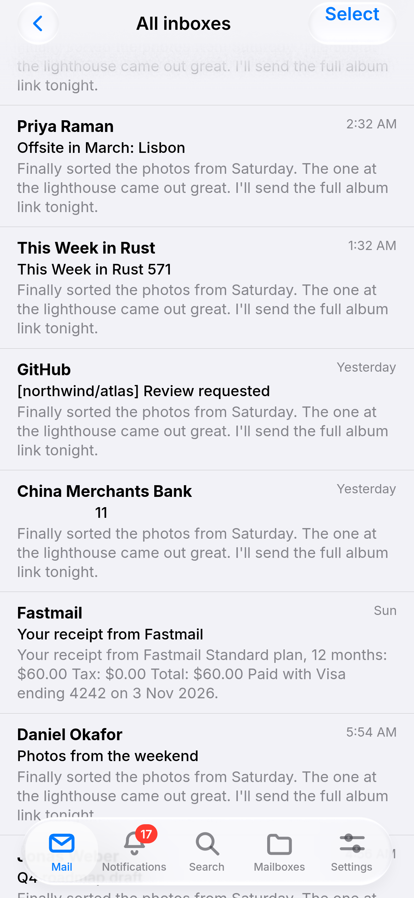
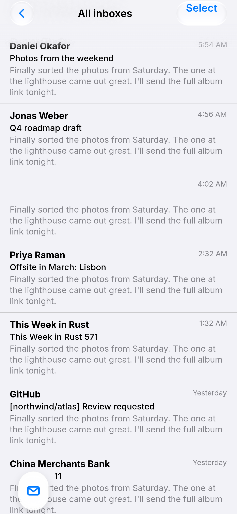
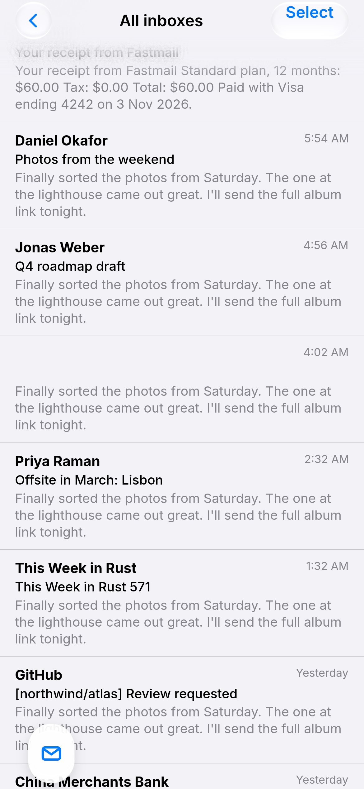

# nsh-cupertino 0.4.2

[English](v0.4.2.md)

这些栏一直是在演示页的色块上构建与调校的；在它们真正浮着的表面上——一页白色、14 pt 深色文字的行——
有三处看起来脏而不是玻璃，还有一处是缺陷。这个版本修掉四处，并加上在行页上（而不是色块上）量出来的检查。

## 修复

- **栏下不再透出文字。** 栏的背景模糊用的是材质的 5 pt，而 14 pt 文字在 5 pt 模糊下仍然是文字：行会变成清晰的灰色条纹，
  深色模式也一样。栏现在以 24 pt、33 次采样做霜化（该半径下 17 次采样的圆盘会显出颗粒），同样的行变成柔和的雾，没有可读笔画。
- **浅色玻璃在白色页上是一个表面。** 白行上的胶囊只比页面高 7–12 级、边缘看不见，最小化胶囊除图标外几乎消失。
  浅色材质再向白抬 5 %，细线更强并带一圈柔和的内带；最小化胶囊是 92 % 的页面色圆盘，配细线与 iOS 27 阴影——
  在白行上不用看图标也能看出形状。深色不画阴影，与 iOS 27 一致。
- **滚动边缘落到页面自己的颜色。** 之前它留下一片灰（带内均值 214，页面 240），带鬼影笔画与一条硬下边。
  现在用页面色不透明地盖住控件，`smoothstep` 在栏下方以平缓切线淡出，模糊在整个渐变里保持 18–40 pt：
  带内 0.954，页面 0.950，偏差 0.000，没有笔画残留。
- **没有色边。** 关闭了边缘的色散；在白色上它表现为所选标签胶囊上一道蓝紫色边。

## 检查

`tools/glass-pixels.mjs` 与 `tools/android-glass-check.mjs` 现在读取**行页**（`glass-rows`：白色页面、14 pt 的发件人/主题/摘要行），并在下列情况让构建失败：

| 检查 | 阈值 | 实测 |
| --- | --- | --- |
| 透过栏的笔画 | 列偏差中位数 < 0.05 | 浅色 0.011、深色 0.024 |
| 白底上胶囊的形状 | 边缘/阴影 ≤ 页面 − 0.05 | 0.87 对 0.95 |
| 深色里的胶囊 | 填充 ≥ 页面 + 0.08 | 0.24 对 0.00 |
| 滚动边缘的颜色 | 与页面相差 ≤ 0.03 | 0.954 对 0.950 |
| 滚动边缘里的笔画 | 偏差 < 0.02 | 浅色 0.000、深色 0.005 |

演示页加上了这一页（`glass-rows`），截图集加上它的各个状态——顶部、边缘、已滚动、最小化，浅色与深色——
让检查跑在文字页上，而不是色块上。

## 前后

浅色，栏覆盖在 14 pt 行上：

| 0.4.1，AgentInbox 的帧（评审用） | 0.4.2，同类页面上的帧 |
| --- | --- |
|  |  |
|  |  |

白行上的最小化胶囊，与滚动边缘：

| 胶囊，0.4.2 | 边缘，0.4.2 |
| --- | --- |
|  |  |

深色：同一分支上的 `glass-rows-scrolled-dark.png`、`glass-rows-edge-dark.png`、`glass-rows-tabmin-dark.png`；
Android 的行页帧是 `android-glass-rows-*`。

## 验证

`cargo fmt`、`cargo clippy --all-targets -- -D warnings`、crate 的测试、Web 构建加 `tools/glass-pixels.mjs`、
站点的无头检查，以及 Android 模拟器运行，都在 pull request 上跑过。
